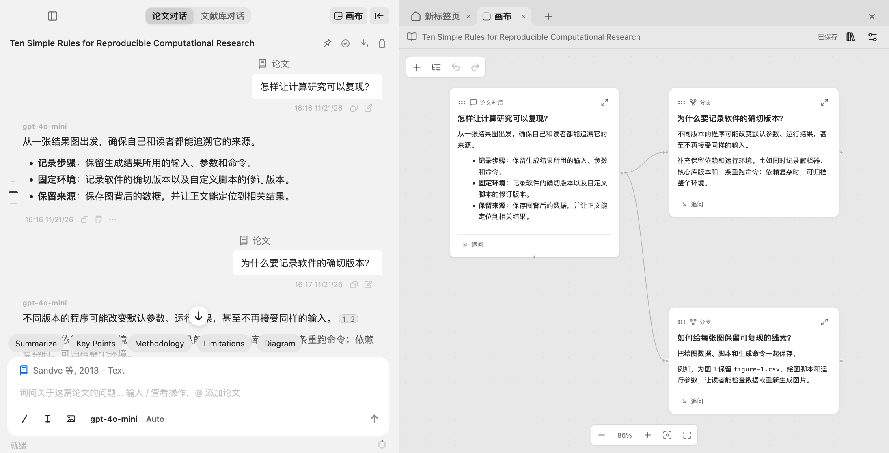
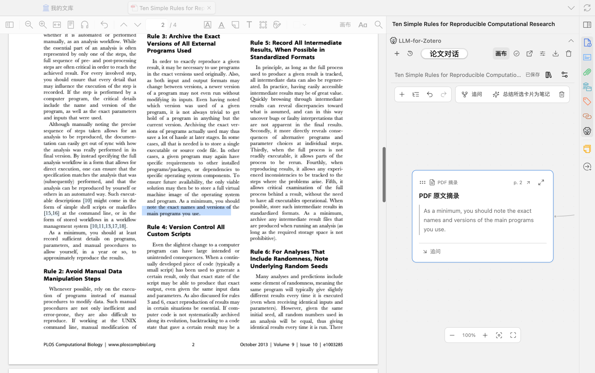
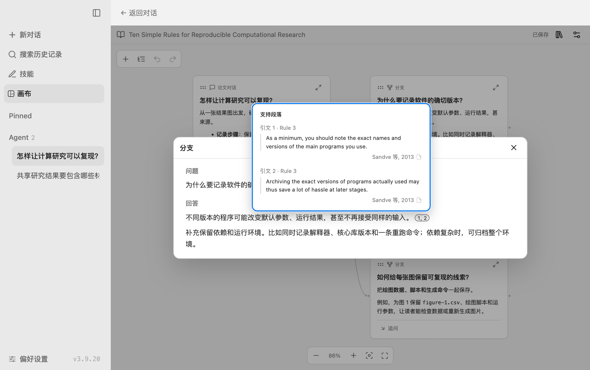

# Canvas Chat

[下载安装包](https://github.com/ForsakenDelusion/zotero-canvas-chat/releases)

**Canvas Chat** 是面向 [LLM-for-Zotero](https://github.com/yilewang/llm-for-zotero) 的独立维护的附属插件。它在同一窗口内把当前论文对话显示为画布，让你基于 PDF 摘录或已有回答继续追问，并把选中的阅读路径整理成带原文跳转的 Zotero 笔记。

## 界面截图

**同一对话，双栏呈现**。左侧是 LLM-for-Zotero 的论文对话，右侧将同一轮问答显示为卡片，并保留从它派生的两条追问分支。



<details>
<summary>查看 PDF 摘录和卡片引用截图</summary>

**PDF 摘录**。在阅读器中选取原文，右侧画布保留摘录和页码。点击页码可跳回 PDF。



**展开卡片查看引用**。在完整回答中点击引用编号，即可查看论文中的支持段落。



</details>

截图取自 Canvas Chat 0.4.22 开发版的 Zotero 界面，问答为演示内容。示例论文为 Sandve 等人（2013）的 [*Ten Simple Rules for Reproducible Computational Research*](https://doi.org/10.1371/journal.pcbi.1003285)（CC BY）。

## 目录

- [功能概览](#功能概览)
- [快速开始](#快速开始)
- [使用指南](#使用指南)
  - [打开与切换画布](#打开与切换画布)
  - [PDF 摘录与原文回跳](#pdf-摘录与原文回跳)
  - [分支追问](#分支追问)
  - [多分支汇聚](#多分支汇聚)
  - [总结所选卡片为笔记](#总结所选卡片为笔记)
  - [整理卡片与画布操作](#整理卡片与画布操作)
- [模型与运行时配置](#模型与运行时配置)
- [数据存储与同步](#数据存储与同步)
- [本地开发与构建](#本地开发与构建)

## 功能概览

- 在 LLM-for-Zotero 侧栏或独立窗口内原位切换**画布**视图，已有问答自动按顺序连成卡片，新回复完成后自动加入。
- 从 PDF 划选文本或框选区域创建**摘录**卡片，保留页码锚点，点击即可跳回 PDF 原文对应位置。
- 从任意卡片或卡片内划选的文字派生**分支**追问，将细节探讨与主线问答清晰分离。
- 选中多条阅读分支发起**汇聚**，将上游脉络合并（共享祖先自动去重）交给同一次推理。
- 支持**总结所选卡片为笔记**，将选中的问答路径整理为结构化的 Zotero 文献子笔记，并保留原文页码跳转。
- 复用 LLM-for-Zotero 的提问框及当前运行时提供的模型、斜杠命令、文献和截图选项。
- 用卡片右上角的展开图标查看完整问题和回答。点击原对话已有的引用编号，可以查看支持段落并跳转到 PDF 原文。
- 一键**整理卡片**自动按问答顺序与分支层级排布画布，画布数据自动保存在文献子笔记中并随 Zotero 同步。

## 快速开始

1. 安装并启用官方 [LLM-for-Zotero v3.9.20](https://github.com/yilewang/llm-for-zotero/releases/tag/v3.9.20)。
2. 从 [Canvas Chat Releases](https://github.com/ForsakenDelusion/zotero-canvas-chat/releases) 下载 `zotero-canvas-chat-<版本>.xpi`。
3. 在 Zotero 中打开 `工具 (Tools)` -> `插件 (Add-ons)` -> 点击右上角齿轮图标 -> 选择 **Install Add-on From File**，选择 `.xpi` 文件完成安装。
4. 打开任意一篇文献的 PDF，在右侧 LLM-for-Zotero 面板顶部点击 **「画布」** 即可切换到当前论文的画布视图。

首发在 macOS 的 Zotero 7.0.32、8.0.4 和 10.0.9 上搭配官方 LLM-for-Zotero 3.9.20 验证。画布使用 LLM-for-Zotero 的窗口和对话控件，宿主更新可能影响兼容性。后续版本可通过 Zotero 检查更新，也可从 Releases 下载后覆盖安装。

## 使用指南

### 打开与切换画布

Canvas Chat 与 LLM-for-Zotero 的当前论文会话保持实时同步，支持在三种入口打开：

- **PDF 阅读器侧栏**：在右侧 LLM-for-Zotero 侧栏顶部点击 **「画布」** 即可在原位切换为画布视图；再次点击可回到传统对话列表。
- **PDF 顶部工具栏**：点击 Zotero PDF 阅读器工具栏上的画布按钮，可直接呼出右侧面板并定位到画布。
- **LLM-for-Zotero 独立窗口**：点击左侧导航栏「技能」下方的 **「画布」**，在主区域查看当前论文对话的画布。左栏可切换历史对话，画布随之更新，点击 **「返回对话」** 即可查看当前所选的对话。点击对话右上角的 **「画布」** 时，宽度充足会打开右侧分栏，窗口较窄时会在主区域打开画布。

### PDF 摘录与原文回跳

- 在 PDF 阅读器中划选正文句子或使用区域批注截取图表，可将其送入右侧画布生成 **PDF 摘录** 卡片（图像分析需当前模型支持视觉输入）。
- 每张摘录卡片以及包含原文锚点的回答都会显示页码标签（如 `p. 3`），点击该标签即可直接跳回 PDF 对应页码与位置。

### 分支追问

在画布中，你可以从任意节点继续深入提问，而不必在单一长列表底部来回翻找上下文：

- **整卡追问**：点击任意卡片底部的 **「追问」** 按钮，基于整张卡片及其上游上下文发起新分支。
- **划词追问**：直接用鼠标在卡片正文内**划选某段文字**，弹出提问框后，选区内容会自动成为新分支的焦点。
- **快捷提问**：在空白追问框中可一键填入「解释一下」「举个例子」「深入一点」等常用提示词，也可修改后再按 `⌘/Ctrl + Enter` 发送。

### 多分支汇聚

当你从不同角度（例如研究动机、核心算法、实验结果）分别派生了多条阅读分支后：

1. 按住 `Shift` 键依次点击选中多张卡片。
2. 在顶部工具栏点击 **「汇聚」** 并输入你的综合问题（例如对比两个分支的结论或汇总完整逻辑链）。
3. 系统会自动收集所有选中卡片的上游脉络（共享的祖先节点只纳入一次），交由模型进行统一的汇聚推理，并在画布上生成一张连接各来源的汇聚卡片。

### 总结所选卡片为笔记

1. 按住 `Shift` 键选中一条或多条有价值的探索路径卡片。
2. 点击顶部工具栏的 **「总结所选卡片为笔记」**。
3. 插件会将所选路径上的问答内容、截图和论文摘要提交给模型，提炼成一份结构化阅读笔记，直接保存为当前 Zotero 文献下的子笔记，并保留原文跳转链接。

### 整理卡片与画布操作

- **自由拖拽**：按住卡片顶部标题栏或边缘留白即可自由拖动调整位置。
- **自动排版**：点击顶部工具栏的 **「整理卡片」**，画布会依据问答先后顺序和分支派生关系自动重新排列所有卡片（排布后支持一键撤销）。
- **视角控制**：支持画布缩放、平移以及一键自适应当前视图范围。

## 模型与运行时配置

- **日常问答、分支追问与汇聚**：提问通过当前论文对话的原版输入栏发送，使用 LLM-for-Zotero 当前选中的运行时。可用选项取决于该运行时的配置。
- **总结生成阅读笔记**：使用官方 LLM-for-Zotero 时，需在画布的 **「模型设置」** 中单独配置笔记整理用的模型。支持 OpenAI 兼容接口、Anthropic 及本地 Ollama。

## 数据存储与同步

- 每篇文献的画布卡片、问答、分支关系与布局会保存在带 `_zcanvas_data` 标签的 Zotero 子笔记中，按文库的同步和共享设置处理。群组文库成员可按其权限访问这些笔记。
- 发起问答或总结时，所选上下文、文献摘录和截图可能传给当前运行时或所配置的模型服务。Canvas Chat 自身没有遥测服务。单独在画布配置的 API 密钥保存在本机 Zotero 首选项中。
- 提交问题时，请提供 Zotero 和 LLM-for-Zotero 的版本、操作步骤及脱敏后的报错信息。

## 本地开发与构建

本地构建需要 Node.js 22.12 或以上版本、npm 和 `zip`。

```sh
npm ci
npm run dev    # 启动浏览器开发预览（使用内置演示数据与模拟流式回答）
npm test       # 运行单元测试
npm run build  # 构建插件安装包（输出至 dist/）
```

Canvas Chat 源码公开供查阅，项目保留自身代码权利。XPI 内附 `THIRD-PARTY-NOTICES.txt`，记录随插件打包的第三方依赖及其许可。
